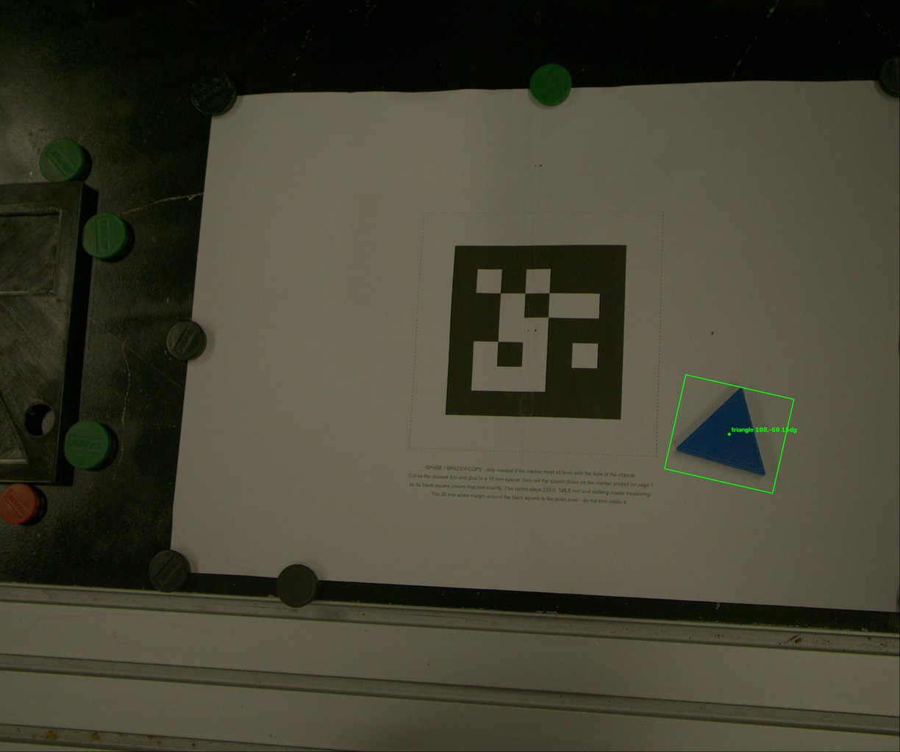
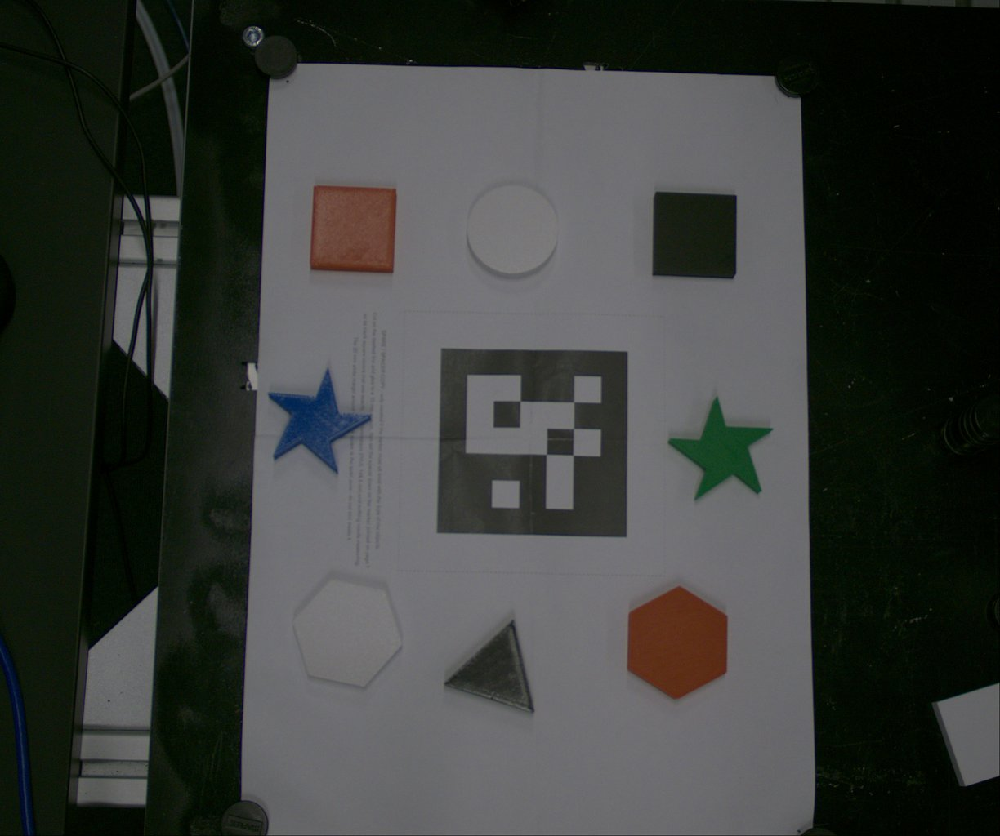
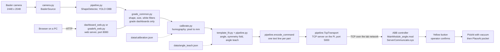
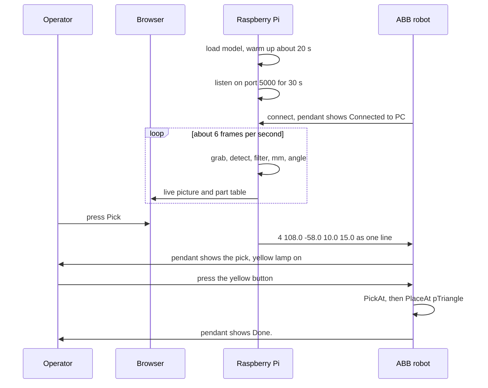

# Vision-Guided Shape Picker

A Raspberry Pi 4 looks at parts on a sheet with a Basler camera. A YOLO model finds each
part's shape, colour, position and angle. The Pi then tells an ABB robot where to pick the
part and which pocket to put it in.


<!-- After the first push, add the CI badge (put your GitHub user name in the link):
 -->

This is a university final project (course INA700). The code is kept exactly as it was handed
in. Only documentation, test set-up and CI were added.

> [!WARNING]
> Three source files are missing from the hand-in (`scripts/dashboard_new.py`,
> `scripts/dashboard.py`, `rapid/updated_robo.mod`), so **the web dashboards do not start yet**
> (`dashboard_web.py`, the grade dashboards, `web_view.py` and both launchers). Calibration,
> angle teaching, `live_pick.py` and the other tools work. To fix it, copy the files into
> place as shown in [Missing files](#missing-files).

<p align="center">
  
  
</p>
<p align="center"><em>Left: one detection drawn by <code>live_pick.py</code> ("triangle 108,-58 15dg" =
x 108 mm, y -58 mm, angle 15 degrees). Right: the sample frame with the ArUco marker and all five shapes.</em></p>

---

## Table of contents

1. [Quick start](#quick-start)
2. [What it does](#what-it-does)
3. [Hardware](#hardware)
4. [How it works](#how-it-works)
5. [One pick, step by step](#one-pick-step-by-step)
6. [Grade levels](#grade-levels)
7. [Installation](#installation)
8. [Calibration and angle teaching](#calibration-and-angle-teaching)
9. [Scripts](#scripts)
10. [Robot and RAPID setup](#robot-and-rapid-setup)
11. [Web dashboard](#web-dashboard)
12. [Adapting to your own cell](#adapting-to-your-own-cell)
13. [Configuration reference](#configuration-reference)
14. [Testing and CI](#testing-and-ci)
15. [Project structure](#project-structure)
16. [Troubleshooting](#troubleshooting)
17. [Missing files](#missing-files)
18. [Known limitations](#known-limitations)
19. [Author](#author)
20. [License](#license)

More detail: [docs/pipeline.md](docs/pipeline.md) (each step with the real numbers) and
[docs/robot_setup.md](docs/robot_setup.md) (the robot side, step by step).

---

## Quick start

### A. Try it on any PC, without camera or robot

You need **Python 3.12 or newer** (see [Installation](#installation) for why).

```bash
git clone <this-repo-url> vision-guided-shape-picker
cd vision-guided-shape-picker
python3 -m venv .venv
source .venv/bin/activate

# 1. CPU-only torch FIRST (otherwise pip pulls the huge CUDA build)
python -m pip install torch torchvision --index-url https://download.pytorch.org/whl/cpu
# 2. everything else
python -m pip install -r requirements.txt

# 3. find the parts in the sample frame.
#    The sample frame does not match data/calibration.json (the marker was in another place),
#    so first make a calibration from the frame itself. It goes to a separate file (ignored by
#    Git); the real data/calibration.json is kept.
python scripts/calibrate.py data/captured_frames/calibration_frame.png \
    --out data/captured_frames/sample_calibration.json
python scripts/live_pick.py --image data/captured_frames/calibration_frame.png \
    --calibration data/captured_frames/sample_calibration.json

# 4. offline check of the whole code path: prints PASS or FAIL per check, writes verify_out/
python scripts/verify_pos_code.py

# 5. run the tests
python -m pytest
```

Step 3 prints one line per part (shape, x and y in mm, angle, and the text line the robot would
get) and writes a picture with the results to
`data/captured_frames/overlay_calibration_frame.png`. Nothing is sent.

### B. On the real cell (Raspberry Pi + camera + robot)

Clone to `~/Documents/pi4` (the launchers expect this folder), install as above, then:

```bash
python scripts/calibrate.py --live      # once, and again after the camera or sheet moves
python scripts/teach_angle.py --show    # check the angle teach (see Calibration and angle teaching)
./grade_levels/run_grade.sh 1           # start a dashboard (needs dashboard_new.py, see Missing files)
# then start RAPID on the robot within 30 s, and open http://<pi-address>:8080 on your PC
```

---

## What it does

- **Live camera:** Basler USB3 camera through `pypylon`, full 2448 x 2048 frames.
- **YOLO oriented boxes:** Ultralytics model "YOLO26n-obb" with 5 classes: circle, square,
  hexagon, star, triangle. Runs as **NCNN** (default) or **ONNX**.
- **Pixel to millimetre** with one printed ArUco marker and a homography. The marker centre is
  (0, 0) in the robot's sheet work object `wobjS`.
- **Precise angle** with a template fit, folded to the shape's symmetry. A **robot angle
  teach** measures the turn direction and the zero angle of each shape.
- **Safety checks:** nothing is sent when the marker has moved, when the angle-teach file is
  broken, or when a shape is not taught. RAPID checks every line again, and the **operator
  confirms every pick** with a yellow button on the robot.
- **TCP link:** the Pi is the server, the robot connects in (port 5000).
- **Web dashboard** (`http://<pi>:8080`): live picture with labels, part table, shape and colour
  filters, Pick button, Save frame. Works over SSH with no screen on the Pi.
- **Three grade-level dashboards** (grade I, II, III) with different operator rules. They also
  add these filters:
  - only **circle, hexagon and triangle** are picked; square and star are dropped, also when
    the model mislabels them (outline check);
  - **pins** (the round magnets that hold the sheet) are dropped by size;
  - **white parts** are dropped (instructor's rule); colours used: red (orange counts as red),
    blue, green, black.
- **Tools** for benchmarking, accuracy measurement, dataset building, annotation and offline
  checks, plus more than 350 headless tests.

> The shape, size and white filters live in `grade_levels/grade_common.py`. **`live_pick.py` and
> the plain `dashboard_web.py` do not use them**: they list and can send all five shapes.

---

## Hardware

Only hardware that the code uses or names:

| Part | What the code expects |
| --- | --- |
| **Raspberry Pi 4** | Runs all the Python code. 64-bit OS with Python 3.12+. The launchers use `~/Documents/pi4` with a `.venv` inside. |
| **Basler USB3 area-scan camera** | Read with `pypylon`. Frame 2448 x 2048 (the code names the acA2440). The first camera found is used. Mounted above the sheet, looking down. |
| **USB buffer setting** | The launchers run `echo 1000 > /sys/module/usbcore/parameters/usbfs_memory_mb` with `sudo`, so 5 MP frames are not dropped. |
| **Printed ArUco marker** | Dictionary `DICT_5X5_100`, **id 0**, black square **100 mm** wide, with a white border. Lies flat on the sheet, nothing on top. |
| **ABB robot + IRC5 controller** | RAPID with socket messaging (the "PC Interface" option on IRC5). |
| **Vacuum cup** | Tool `toolss`, valve on digital output `doValve1`. |
| **Yellow lamp + button** | Digital output `doYellowLamp`, digital input `diYellowBtn`. |
| **Network** | Pi and robot controller on the same subnet (the lab used `192.168.125.x`). The robot connects to the Pi on TCP port 5000. |
| **Parts** | Flat parts about 45-50 mm wide and 10 mm high: circle, hexagon, triangle (picked by the grade dashboards), square, star. |
| **Tray** | One pocket per shape (five pockets), taught as targets in work object `wobjD`. |
| **PC (optional)** | Any browser for the dashboard. RobotStudio or the FlexPendant to load the RAPID files. |

---

## How it works



For each part (numbers are the defaults in the code):

1. **Camera.** `BaslerSource` grabs colour frames. The dashboard grabs only 6 frames per second
   so the Pi's CPU is free for the model. The browser gets a half-size picture (1224 px wide).
2. **Detection.** `ShapeDetector` loads the weights (`best_ncnn_model/` first, then `best.onnx`,
   then `best.pt`). Input size 640, confidence 0.25. The model must have exactly the classes
   `circle, square, hexagon, star, triangle` in this order, or the program stops.
3. **Filters** (grade dashboards only): keep circle, hexagon, triangle; drop a detection whose
   outline looks like a star or a square; drop parts under 38 mm (pins); drop white parts.
4. **Pixel to mm.** The 3 x 3 homography in `data/calibration.json` turns the part centre into
   millimetres from the marker centre: **+x = image right, +y = image up**. It also removes the
   perspective of a camera that is not exactly above the sheet.
5. **Angle.** A template of the shape is fitted to the part outline. The angle is folded to the
   shape's symmetry (hexagon 60 deg, triangle 120 deg, square 90 deg, star 72 deg; a circle
   always gets 0). Then the angle teach is applied:
   `angle = sign * fold(raw angle - theta0 of that shape)`.
6. **Command.** One text line per part: `slot;x;y;z;angle`, one decimal each, for example
   `4;108.0;-58.0;10.0;15.0`. Slots: circle 1, square 2, hexagon 3, triangle 4, star 5. z is
   always 10 mm (the part height).
7. **Robot.** RAPID reads the line, checks it, waits for the yellow button, picks the part in
   `wobjS` with the cup turned by the angle, and places it in that shape's pocket in `wobjD`.

The maths and every threshold: [docs/pipeline.md](docs/pipeline.md).

---

## One pick, step by step

A worked example with the grade I dashboard and the blue triangle from the picture at the top.



1. **Start.** `./grade_levels/run_grade.sh 1` loads `data/angle_teach.json` and
   `data/calibration.json`, opens the camera, loads the model and warms it up (about 20 s, prints
   "model ready"). Then it listens on `192.168.125.205:5000` and waits **30 s** for the robot.
2. **Robot connects.** On the FlexPendant: PP to Main, PLAY. The robot goes to `Start`, shows
   "Waiting for PC ...", connects, and shows "Connected to PC.".
3. **See the part.** The camera thread grabs a frame. The model finds a box labelled
   *triangle* with confidence above 0.25. It is an assigned shape, it is about 50 mm big (not a
   pin), its outline is solid with 3 corners (not a star or square), and it is blue (not white),
   so it is kept.
4. **Position.** The triangle's centre comes from the template fit (a triangle's box centre is
   not its real centre). The homography turns it into about **x = 108 mm, y = -58 mm** from the
   marker centre.
5. **Angle.** Say the template fit measures a raw angle of about -44.6 deg. The shipped
   angle teach has, for the triangle, `theta0 = -29.55` and `sign = -1`:
   `-1 * fold120(-44.6 - (-29.55)) = -1 * (-15.05) = about +15 deg`.
6. **Table.** The browser shows the row `blue triangle ... 108 -58 15`. The part that Pick
   will send is marked **NEXT** (yellow).
7. **Pick.** The operator presses **Pick**. The Pi checks that the triangle is taught, removes
   the row, and sends the line `4;108.0;-58.0;10.0;15.0` plus a newline (slot 4 = triangle).
8. **RAPID checks it.** The pendant shows the line. `ParseMsg` finds five numbers. Slot 1-5: ok.
   x and y inside +-200 mm, z inside 0-40 mm: ok. Angle inside +-180 deg: ok.
9. **Operator confirms.** Pendant: `Pick X=108.0 Y=-58.0 Z=10.0 A=15.0` and
   "Press the yellow button to pick.". The yellow lamp is on. The operator presses the button.
10. **Pick.** The robot builds the target from `pickBase` (cup-down pose) at (108, -58, 10) in
    `wobjS`, turned 15 deg about the cup axis. It moves to 60 mm above it, goes straight down,
    switches the vacuum on, waits 1 s, and lifts 60 mm.
11. **Place.** Slot 4 gives target `pTriangle` in `wobjD`. The robot moves above the pocket,
    goes down, switches the vacuum off, waits 1 s, lifts. Pendant: **"Done."**.
12. **Next part.** The grade I panel now says "1 of 3 shapes sent". Wait for "Done." before
    the next Pick. If the pick missed, press Pick again (the part is still in view).

---

## Grade levels

`grade_levels/` has three dashboards built on `scripts/dashboard_web.py`. They share the camera,
model, calibration and robot code, and only change the operator rules:

| Grade | Script | The operator can |
| --- | --- | --- |
| I (E) | `grade1_web.py` | Press Pick only. One cycle: all three shapes, any order. |
| II (D) | `grade2_web.py` | Choose a **colour**. A cycle ends when the three shapes are sent; press **Start next cycle** to go on. |
| III (C, B-A) | `grade3_web.py` | Choose the **shape** (required) and the colour for every pick. Up to 3 attempts per shape per cycle. |

Grade options (on top of the `dashboard_web.py` options): `--conf` (default 0.25),
`--no-shape-check`, `--min-size-mm` (default 38, 0 = off), `--allow-white`.
Full rules and the class design: [grade_levels/README.md](grade_levels/README.md).

---

## Installation

### 1. Python version

Use **Python 3.12 or newer**. The code itself needs 3.11 (`typing.Self`), but
`requirements.txt` pins `numpy==2.5.3`, which has no wheel for Python 3.11.
On the Pi this means a Raspberry Pi OS based on Debian 13 "Trixie" (Python 3.13). The older
"Bookworm" release has Python 3.11, which is too old for these pins.

### 2. Virtual environment and packages

```bash
cd ~/Documents/pi4
python3 -m venv .venv
source .venv/bin/activate
python -m pip install --upgrade pip

python -m pip install torch torchvision --index-url https://download.pytorch.org/whl/cpu   # FIRST
python -m pip install -r requirements.txt
python -m pip check
```

**Why torch first?** If you install `requirements.txt` first, pip takes torch from PyPI, and the
Linux wheel pulls the whole CUDA stack (more than a gigabyte) onto the Pi. Ultralytics needs
torch even for NCNN weights, so it cannot be left out. It only has to be the CPU build.
(The comment in `requirements.txt` points to "PI4_QUICKSTART step 2", a note that was not in the
hand-in; it is the same torch step as above.)

| Package | Note |
| --- | --- |
| `ultralytics==8.4.174` | Loads the YOLO OBB weights. |
| `opencv-python` | **Not** the headless build: `live_view.py`, `camera.py` and `basler_live.py` open windows. |
| `pypylon==26.8` | Basler camera. The Linux wheel already contains the pylon runtime. Only needed with the camera. |
| `ncnn` | Needed for `best_ncnn_model` (the default). |
| `onnxruntime` | Only needed with `--model runs/obb/obb_train/weights/best.onnx`. |
| `pytest` | Tests. |

For the tests only (no torch, no camera): `python -m pip install -r requirements-dev.txt`.

### 3. Model weights

The trained weights are in the repo (about 10 MB each):

```
runs/obb/obb_train/weights/best.onnx
runs/obb/obb_train/weights/best_ncnn_model/   (model.ncnn.bin, model.ncnn.param, metadata.yaml)
```

The training file `best.pt` is not included. Git LFS is not needed.

### 4. Folder location

`run_dashboard.sh` and `grade_levels/run_grade.sh` start with `cd ~/Documents/pi4` and
`source .venv/bin/activate`. Clone to `~/Documents/pi4`, or change those two lines in your copy.
The Python scripts find the repo root by themselves (they look for `runs/obb/`). A few relative
default paths (`--overlay` of `live_pick.py`, `verify_out/`, `measure_accuracy.py`) assume you
run from the repo root, so always start the scripts from there.

---

## Calibration and angle teaching

Do this on the real cell. Re-do the **calibration** when the camera, the sheet or the marker
moves. Re-do the **angle teach** when `pickBase` or `wobjS` is re-taught on the robot.

### A. Teach `wobjS` on the robot

The sheet work object `wobjS` must have its **origin at the marker centre**, **x to the image
right** and **y to the image up** (as the camera sees it). Python sends millimetres in this frame.

### B. Camera calibration (`calibrate.py`)

1. Lay the 100 mm ArUco marker (`DICT_5X5_100`, id 0) flat in view, with nothing on top.
2. Run:
   ```bash
   python scripts/calibrate.py --live
   # or from a saved frame:
   python scripts/calibrate.py path/to/frame.png
   ```
   With `--live` it tries up to 10 frames. If none has the marker, it saves the last one as
   `calib_fail.png` in the current folder.
3. It writes `data/calibration.json` (homography, marker centre in pixels, side lengths, rotation).

Options: `--marker-mm` (measured printed edge, default 100), `--id` (default 0), `--out` (JSON path).

Later runs compare the marker in each new frame with the saved one:

- `live_pick.py`, `verify_positions.py` and `teach_angle.py` **stop** if it moved more than 15 px
  ("the marker has moved ... re-run calibrate.py --live").
- The dashboard shows the drift and turns it red ("MOVED") above 6 px.
- If the marker is covered or out of view, this check cannot run and is skipped.

### C. Angle teach (`MainModule_angle.mod` + `teach_angle.py`)

The robot drops a part twice (turned 0 and turned 20 deg) and the camera measures both. This
gives the robot's turn direction (`sign`) and each shape's zero angle (`theta0`). It is done for
square, hexagon, triangle and star. A circle has no angle.

1. Put the part(s) **seated in their pockets**. Keep the drop point on the sheet free
   (`nTeachX = -120`, `nTeachY = 60` in wobjS mm).
2. FlexPendant: **PP to Routine** -> `TeachAll` (or `TeachSquare`, `TeachHexagon`,
   `TeachTriangle`, `TeachStar`). Answer **Yes** to "Is the part SEATED in its pocket and the
   drop point on the sheet EMPTY?".
3. The robot takes the part out of its pocket, drops it with turn 0, moves to `Start` and stops.
   On the Pi run the command the pendant shows, for example:
   ```bash
   python scripts/teach_angle.py --turn 0 --shape triangle
   ```
   Press **PLAY**. The robot puts the part back, then drops it again turned 20 deg:
   ```bash
   python scripts/teach_angle.py --turn 20 --shape triangle
   ```
   Press **PLAY** again; the part goes back into its pocket.
4. The result is saved in `data/angle_teach.json`. Check or edit it:
   ```bash
   python scripts/teach_angle.py --show
   python scripts/teach_angle.py --forget star     # remove one shape
   ```

Rules the code enforces (a refused step stores nothing):

| Rule | Value |
| --- | --- |
| `--turn 20` must follow `--turn 0` | within 15 minutes |
| Part position vs. drop point | within 15 mm |
| Measured turn vs. 20 deg | within 3 deg |
| Spread between the live frames (median of 5, `--frames`) | at most 2 deg |
| Template fit must be used (not the outline fallback) | unless `--allow-fallback` |
| All taught shapes agree on the sign | otherwise the file is ignored |

When the teach file is in use:

- If the file exists but cannot be used, **sending is refused** (`live_pick.py --send` and
  `dashboard_web.py --send` stop at start).
- If a shape with an angle is not taught, **picks of that shape are refused**.

If you change `nTeachX` / `nTeachY` in RAPID, pass the same values as `--drop-x` / `--drop-y`.

> The script's messages say "AngleTeach.mod". In this version those routines are inside
> `rapid/MainModule_angle.mod`.

---

## Scripts

Run everything from the repo root with the venv active. Every script with options shows them
with `--help`.

### Main scripts

| Script | What it does | Example |
| --- | --- | --- |
| `grade_levels/run_grade.sh N` | Pi launcher for grade 1, 2 or 3: stops old viewers, sets the USB buffer, runs `gradeN_web.py --camera --send --host 192.168.125.205`. Extra options are passed on. | `./grade_levels/run_grade.sh 3 --imgsz 512` |
| `grade_levels/gradeN_web.py` | Grade dashboard. Same options as `dashboard_web.py` plus the grade options. | `python grade_levels/grade2_web.py --camera --send --host 192.168.125.205` |
| `scripts/dashboard_web.py` | Web dashboard without grade rules (all five shapes). | `python scripts/dashboard_web.py --camera --send --host 192.168.125.205` |
| `scripts/live_pick.py` | One frame -> table in mm, overlay picture, and with `--send` all lines to the robot. | `python scripts/live_pick.py --image frame.png` |
| `scripts/calibrate.py` | ArUco marker -> `data/calibration.json`. | `python scripts/calibrate.py --live` |
| `scripts/teach_angle.py` | One angle-teach step, or `--show` / `--forget`. | `python scripts/teach_angle.py --show` |
| `scripts/camera.py` | Live camera: two OpenCV windows (live + edges), or a web page with `--web`. S saves a frame, Q quits. | `python scripts/camera.py --web` |

### `dashboard_web.py` options

| Option | Default | Meaning |
| --- | --- | --- |
| `--camera` | off | Use the Basler live. Without it, replay an image folder. |
| `--folder` | from `dashboard_new.py` | Image folder to replay without `--camera`. |
| `--send` | off | Really send picks to the robot. Without it: dry run, the line is only printed. |
| `--host` | from `dashboard_new.py` | **The Pi's own** address on the robot network, to listen on. |
| `--port` | from `dashboard_new.py` | TCP port the robot connects to (RAPID uses 5000). |
| `--record` | off | Let **Save frame** write to `data/captured_frames/` (needs `--camera`). |
| `--angle-offset` | 0.0 | Degrees added before the symmetry fold. |
| `--model` | `best_ncnn_model` | Weights path. |
| `--imgsz` | 640 | Network input size. 480 or 512 is faster. |
| `--web-port` | 8080 | Browser port. |

### `live_pick.py` options

| Option | Default | Meaning |
| --- | --- | --- |
| `--image PATH` | (camera) | Saved frame. Without it, one Basler frame is grabbed. |
| `--calibration` | `data/calibration.json` | Calibration file. |
| `--conf` | 0.25 | Detector confidence. |
| `--model` | best found | Weights path. |
| `--scalar` | off | Simple one-number scale instead of the homography. Not allowed with `--send`. |
| `--angle-offset` | 0.0 | Degrees added before the symmetry fold. |
| `--overlay PATH` | `data/captured_frames/overlay_<name>.png` | Where to write the picture. |
| `--no-overlay` | off | Write no picture. |
| `--send` | off | Send all lines to the robot (nearest part first). Needs `--host`. |
| `--host` | none | The Pi's own address; required with `--send`. |
| `--port` | 5000 | TCP port to listen on. |
| `--allow-fallback` | off | Also send angled parts whose template fit failed. |

Rows are marked `[UNTAUGHT]` or `[FALLBACK]` when they must not be sent.

### Other tools

| Script | What it does | Needs |
| --- | --- | --- |
| `scripts/verify_pos_code.py` | Offline check of the whole code path on the sample frame (model, marker, folds, wire format, TCP loopback, RAPID text). Writes `verify_out/`. | Model |
| `scripts/rehearse_grade1.py` | Grade I dry run over 127.0.0.1: three shapes in, three lines out, no robot. | Model |
| `scripts/verify_positions.py` | Pick table plus a RAPID module `VisionCheck.mod`. Load it next to `MainModule_angle.mod` and run `CheckAll`: the cup goes to each point, no vacuum. `--safe-z`, `--rapid`, `--no-rapid`. | Model, calibration |
| `scripts/template_fit.py` | Compares the template-fit angle with the outline/box angle, part by part. Writes `template_check.png`. | Model |
| `scripts/live_view.py` | Live view with every step drawn (detections, template fit, mould view). `--image`, `--manual`, `--clearance`, `--once FOLDER`. | Model, screen (or `--once`) |
| `scripts/web_view.py` | View-only browser page, nothing is sent. `--raw`, `--port`, `--model`, `--conf`. | `dashboard_new.py` (missing) |
| `scripts/basler_live.py` | Simplest camera test: live + edges, S saves, Q quits. Exactly one camera must be connected. | Camera, screen |
| `scripts/bench_infer.py` | Times the model against the 3 s limit (default frames: `data/captured_frames/`). `--frames`, `--limit`, `--repeat`, `--budget-ms`. | Model |
| `scripts/measure_accuracy.py` | Centre and angle error per shape against validation labels. | `data/dataset/` (not included) |
| `scripts/prepare_dataset.py` | Builds the YOLO dataset from `data/raw/` and `data/labels_obb/`. | Raw images (not included) |
| `scripts/optimized_anno_img.py` | OpenCV tool to draw oriented-box labels (1-5 class, S save+next, F flag, Q quit, ...). | Raw images, screen |
| `scripts/pocket.py` | How much angle error a pocket accepts, plain or chamfered. `--size-mm`, `--gap-mm`, `--chamfer-mm`, `--error-deg`. | Nothing |
| `scripts/yolo_obb.py` | Stand-alone detection on camera or files. No options: edit `SOURCE` at the top. | Model |
| `scripts/robot_server.py` | Manual TCP test: listen, type lines, see the robot's reply. Address is in the file. | Network |
| `run_dashboard.sh` | Old launcher for `dashboard.py` (or `dashboard_new.py` with `new`). | Missing files |

---

## Robot and RAPID setup

Short version. Full steps: [docs/robot_setup.md](docs/robot_setup.md).

1. **Load the modules** (RobotStudio or FlexPendant):
   `ServerCommuncatio.sys` as a **system module** (socket helpers), and
   `rapid/MainModule_angle.mod` as the **program module** with `PROC main()`.
2. **I/O signals** `doValve1` (vacuum), `doYellowLamp`, `diYellowBtn` must exist.
3. **Teach the data** in `MainModule_angle.mod`: `toolss`, `wobjS` (origin at the marker centre),
   `wobjD` (tray), `pickBase` (cup-down pose), the pocket targets `pCircle`, `pSquare`, `pHex`,
   `pTriangle`, `pStar`, and `Start` (home). The values in the file come from the lab cell and
   **will not fit another cell**. Check the pockets with PP to Routine -> `CheckTargets`.
4. **Network:** the robot is the TCP **client**. `ServerCommuncatio.sys`, line 52:
   ```
   SocketConnect robotClient, "192.168.125.205", 5000;
   ```
   Put your **Pi's** address and port here, and give the Python side the same address in
   `--host` (the launchers use `192.168.125.205`).
5. **Start order:** start the Pi side first (it waits **30 s**), then on the pendant PP to Main
   and PLAY. The pendant shows "Connected to PC.".
6. **One part** = one **Pick** on the web page + one **yellow button** press. Wait for
   **"Done."** before the next Pick.
7. If the Pi closes the link, RAPID shows "PC disconnected - waiting for it again..." and
   reconnects by itself. The line `quit` ends the program and sends the arm to `Start`.

---

## Web dashboard

Start it on the Pi (over SSH is fine):

```bash
./grade_levels/run_grade.sh 1
# or
python scripts/dashboard_web.py --camera --send --host 192.168.125.205
```

Open `http://<pi-address>:8080` on your PC. The console prints the address.

On the page:

- **Live picture**: box, centre cross, direction arrow, `colour shape` and `x y angle` for each
  part. The **NEXT** part (the one Pick sends) is yellow.
- **ArUco line**: marker centre, angle and drift from the calibration. "MOVED" or "NOT FOUND"
  is red.
- **Part table**: colour, shape, confidence, x mm, y mm, angle, and a note if a pick would be
  refused.
- **Pick by shape / colour** filters (grade pages show only the filters that grade allows).
- **Pick** sends the NEXT part. The title says "LIVE" with `--send`, or "dry run" without it.
- **Save frame** writes the full frame to `data/captured_frames/` (only with `--record`).
- Grade pages add a panel with the cycle state, the inference time (red above 3 s) and
  **Start next cycle**.

> Anyone who can open the page can press Pick. The web server listens on all network cards
> (`0.0.0.0`) and has no login. Keep the Pi on the closed lab network.

Only one program can use the camera. Stop `web_view.py`, `camera.py` or another dashboard first
(the launchers do this with `pkill`).

---

## Adapting to your own cell

The repo is set up for one lab cell. To run it on another cell, go through this list.

### 1. Network

| Change | Where |
| --- | --- |
| The Pi's address on the robot network | `ServerCommuncatio.sys` line 52, and `--host` when you start the Pi side |
| The two launchers | `grade_levels/run_grade.sh` and `run_dashboard.sh` (`--host 192.168.125.205`) |
| The manual test server | `HOST` and `PORT` at the top of `scripts/robot_server.py` |
| The port (if not 5000) | `ServerCommuncatio.sys` line 52 and `--port` |

`--host` must be the **Pi's own** address (`hostname -I`), never the robot's. If a firewall runs
on the Pi, open TCP 5000 (robot) and 8080 (browser).

### 2. Robot data (re-teach)

Re-teach in `MainModule_angle.mod`: `toolss` (cup TCP), `wobjS` (origin at the marker centre,
x = image right, y = image up), `wobjD` (tray), `pickBase` (cup pointing down, a good arm
configuration), the five pocket targets and `Start` (out of the camera view). Check with
`CheckTargets`. If your I/O signals have other names, rename them in the module.

### 3. Camera calibration (re-run)

Print the marker (`DICT_5X5_100`, id 0), measure the black square and pass it with
`--marker-mm` if it is not exactly 100 mm. Run `python scripts/calibrate.py --live`.

### 4. Angle teach (re-run)

Choose a free drop point that the camera sees and the arm at `Start` does not hide. Set
`nTeachX` / `nTeachY` in RAPID, pass the same values with `--drop-x` / `--drop-y`, and run the
teach for each shape (see [Calibration and angle teaching](#calibration-and-angle-teaching)).

### 5. Check before the first real pick

```bash
python scripts/verify_positions.py           # table + VisionCheck.mod
```

Load `VisionCheck.mod` next to `MainModule_angle.mod`, run `CheckAll` in manual reduced speed
and watch the cup touch each part top (no vacuum). Then run the first picks in manual mode too.

### 6. Other parts or a different setup (code changes in your fork)

| If you change | Edit | Then redo |
| --- | --- | --- |
| Part sizes | `SQUARE_SIDE_MM`, `TRIANGLE_SIDE_MM`, `HEXAGON_FLATS_MM`, `STAR_*` in `scripts/template_fit.py` | angle teach |
| Part height | `PICK_Z_MM` in `scripts/pipeline.py` and `nTeachH` in RAPID | angle teach |
| Pin size limit | `--min-size-mm` (grade dashboards) | - |
| Which shapes are picked | `ALLOWED_CLASS_IDS` in `scripts/pipeline.py` | - |
| Safe area (+-200 mm, z 0-40 mm) | `main()` and `TeachPointOk()` in `MainModule_angle.mod` | - |
| Other shapes or colours of parts | retrain the model; the class order must match `CLASSES` in `pipeline.py` | everything |
| Camera moved | - | calibration, and check `wobjS` |
| `pickBase` or `wobjS` re-taught | - | angle teach |

---

## Configuration reference

Nothing secret is stored. All values that belong to the lab cell:

| What | Where | Value in this repo |
| --- | --- | --- |
| Pi address the robot connects to | `ServerCommuncatio.sys` line 52, `--host` | `192.168.125.205` |
| TCP port | `ServerCommuncatio.sys` line 52, `--port` | `5000` |
| Pi address in the launchers | `run_dashboard.sh`, `grade_levels/run_grade.sh` | `192.168.125.205` |
| Test server | `scripts/robot_server.py` (`HOST`, `PORT`) | `192.168.125.205`, `5000` |
| Robot address (only in hint messages, and the unused default of `TcpTransport`) | `pipeline.py`, `live_pick.py` | `192.168.125.2` |
| Robot-as-server example (unused) | `ServerCommuncatio.sys`, `ServerCreateAndConnect` | `192.168.125.1:5000` |
| Web port | `--web-port` (dashboards), `--port` (`camera.py --web`, `web_view.py`) | `8080` |
| Repo folder for the launchers | `run_dashboard.sh`, `run_grade.sh` | `~/Documents/pi4` |
| Camera calibration | `data/calibration.json` | lab cell |
| Angle teach | `data/angle_teach.json` | lab cell, taught 2026-11-01 |
| Marker size / id | `calibrate.py --marker-mm --id` | 100 mm, id 0 |
| Angle-teach drop point | `nTeachX`, `nTeachY` in RAPID; `--drop-x`, `--drop-y` | -120, 60 mm |
| Angle-teach test turn | `nTeachTurn` in RAPID (1-26 deg) | 20 deg |
| Part sizes for the template fit | `scripts/template_fit.py` | square 45, triangle 50, hexagon 50 mm |
| Shapes the grade dashboards pick | `ALLOWED_CLASS_IDS` in `pipeline.py` | circle, hexagon, triangle |
| Pick height | `PICK_Z_MM` in `pipeline.py` | 10 mm |
| RAPID safe area | `main()` in `MainModule_angle.mod` | x, y +-200 mm; z 0-40 mm |
| Marker drift limits | `MOVED_LIMIT_PX` (`calibrate.py`), `DRIFT_WARN_PX` (`dashboard_web.py`) | 15 px stop, 6 px warning |

---

## Testing and CI

The tests need no camera, no robot and no screen.

```bash
python -m pip install -r requirements-dev.txt   # or the full install above
python -m pytest                                # all tests (settings in pytest.ini)
python -m pytest tests/test_calibrate.py -q     # one file
python -m pytest -rs                            # also list why tests were skipped
```

`pytest.ini` puts `scripts/`, `grade_levels/` and `tests/` on the import path. `tests/conftest.py`:

- resets the angle-teach values in `pipeline.py` after each test, so the real
  `data/angle_teach.json` cannot leak from one test into the next;
- leaves out or skips **only** the tests that need a [missing file](#missing-files), and prints
  why at the top and bottom of the run. When you add the file, those tests run again by
  themselves.

Result in this copy (Python 3.13, without torch/ultralytics):

```
364 passed, 21 skipped        (+ 2 test files not collected)
```

| Tests | State | Reason |
| --- | --- | --- |
| most files | pass | |
| `test_pipeline.py`, 5 tests | skipped without ultralytics | `detections_from_result` imports `ultralytics` (and so torch) |
| `test_angle_teach.py`, 7 tests | skipped | sample frame `scripts/frame_20261030_171238_018578.png` not included |
| `test_updated_robo.py`, 9 tests | skipped | `rapid/updated_robo.mod` not included |
| `test_grade_levels.py` | not collected | needs `scripts/dashboard_new.py` |
| `test_dashboard.py` | not collected | needs `scripts/dashboard.py` and tkinter |

**GitHub Actions** ([.github/workflows/tests.yml](.github/workflows/tests.yml)) runs on every
push and pull request:

- `light`: Python 3.13 with `requirements-dev.txt` only;
- `full`: Python 3.12 and 3.13, CPU torch from the PyTorch CPU index, then `requirements.txt`
  (so the 5 ultralytics tests run too).

The missing files do not make CI fail, for the reason above.

---

## Project structure

```
vision-guided-shape-picker/
├── README.md, LICENSE, CHANGELOG.md, CONTRIBUTING.md
├── requirements.txt          # runtime (install CPU torch first)
├── requirements-dev.txt      # tests only
├── pytest.ini                # test import paths
├── .github/workflows/tests.yml   # CI
├── run_dashboard.sh          # old launcher (needs the missing dashboard.py / dashboard_new.py)
├── ServerCommuncatio.sys     # RAPID system module: socket helpers (robot = client)
├── rapid/
│   └── MainModule_angle.mod  # RAPID main: receive, check, yellow button, pick, place, angle teach
├── scripts/
│   ├── pipeline.py           # core library: Detection, PickCommand, angles, wire format, TCP
│   ├── calibrate.py          # ArUco -> homography -> data/calibration.json
│   ├── template_fit.py       # precise centre + angle
│   ├── camera.py             # BaslerSource + live view
│   ├── dashboard_web.py      # web dashboard (needs dashboard_new.py)
│   ├── live_pick.py          # one frame -> pick commands (+ --send)
│   ├── teach_angle.py        # angle teach -> data/angle_teach.json
│   ├── live_view.py, web_view.py, basler_live.py
│   ├── verify_positions.py, verify_pos_code.py, rehearse_grade1.py
│   ├── bench_infer.py, measure_accuracy.py, pocket.py
│   ├── prepare_dataset.py, optimized_anno_img.py, yolo_obb.py
│   └── robot_server.py       # manual TCP test
├── grade_levels/
│   ├── README.md             # grade rules
│   ├── grade_common.py       # GradeController, filters, page, launch()
│   ├── grade1_web.py, grade2_web.py, grade3_web.py
│   └── run_grade.sh          # Pi launcher
├── data/
│   ├── calibration.json      # camera -> sheet homography (lab cell)
│   ├── angle_teach.json      # robot angle teach (lab cell)
│   └── captured_frames/
│       ├── calibration_frame.png   # sample frame, default input of several tools
│       └── overlay_live.png        # example live_pick.py picture
├── runs/obb/obb_train/weights/
│   ├── best.onnx
│   └── best_ncnn_model/      # default
├── tests/                    # pytest, headless
│   └── conftest.py           # test isolation + missing-file handling (added for GitHub)
└── docs/
    ├── pipeline.md, robot_setup.md
    └── images/               # small copies of the two sample frames
```

Files the tools create at run time are ignored by `.gitignore`: new frames and overlays in
`data/captured_frames/`, `data/mould/`, `data/mould.json`, `calib_fail.png`,
`template_check.png`, `VisionCheck.mod`, `verify_out/`, `data/raw/`, `data/labels_obb/`,
`data/dataset/`, `data/previews/`.

---

## Troubleshooting

| Problem | What to do |
| --- | --- |
| `ModuleNotFoundError: No module named 'dashboard_new'` | `scripts/dashboard_new.py` is missing. See [Missing files](#missing-files). |
| `No matching distribution found for numpy==2.5.3` | Your Python is 3.11 or older. Use Python 3.12+. |
| pip downloads `nvidia-...` packages / the disk fills up | You installed `requirements.txt` before torch. Delete the venv and install CPU torch first. |
| `Permission denied` for `./grade_levels/run_grade.sh` | Run `chmod +x grade_levels/run_grade.sh run_dashboard.sh`, or start it with `bash grade_levels/run_grade.sh 1`. |
| `weights not found` | Check that `runs/obb/obb_train/weights/best_ncnn_model/` exists, or pass `--model .../best.onnx`. |
| `model classes (...) != frozen CLASSES` | The weights do not have the five classes in the right order. Use the shipped weights. |
| `no Basler camera detected` | Check the USB3 cable and power. Only one program can open the camera: stop the others (`pkill -f scripts/`). |
| Frames drop / grab errors | `sudo sh -c 'echo 1000 > /sys/module/usbcore/parameters/usbfs_memory_mb'` (the launchers do it). |
| `cannot listen on ...: that address is not one of this machine's addresses` | `--host` must be the **Pi's** own address (`hostname -I`), not the robot's. |
| `another program already listens on this port` | Stop the old dashboard, or use `--port 5001` and change RAPID to match. |
| `robot link failed: no connection within 30 s` | Start RAPID within 30 s of the dashboard. Check the address in `ServerCommuncatio.sys`, cables and firewall. |
| `the marker has moved ... px` | Re-run `calibrate.py --live`. If the sheet moved, also re-teach `wobjS`. |
| `REFUSED to send: the angle teach file exists but is not used` | Fix or re-teach (`teach_angle.py --show`), or move `data/angle_teach.json` away to use the defaults. |
| `REFUSED <shape>: ... not taught` | Run the angle teach for that shape. |
| `REFUSED <shape>: angle from the outline/box FALLBACK` | Better light, or `--allow-fallback` if you accept the less exact angle. |
| Pendant: `Outside the sheet - ignored.` | The point is more than 200 mm from the marker centre, or z is outside 0-40 mm. Check calibration and `wobjS`. |
| Pendant: `Bad message: ...` | The line was not `slot;x;y;z;angle`. Send one pick at a time (see [Known limitations](#known-limitations)). |
| Inference slower than 3 s | Use `--imgsz 512` or `480`. Do not run other camera viewers at the same time. |
| `calibrate.py` cannot read the image ("OneDrive") | The file is a cloud placeholder; make it available offline. |

---

## Missing files

These files were not in the hand-in. The project owner has been asked for them. When you get
them, copy each one to the place below. No other change is needed: imports, launchers and tests
find them there.

| File | Copy it to | What starts working |
| --- | --- | --- |
| `dashboard_new.py` | `scripts/dashboard_new.py` | `dashboard_web.py`, the grade dashboards, `run_grade.sh`, `web_view.py`, `run_dashboard.sh new`, and `tests/test_grade_levels.py`. It also gives the defaults of `--host`, `--port` and `--folder`. |
| `dashboard.py` | `scripts/dashboard.py` | `run_dashboard.sh` (default) and `tests/test_dashboard.py` (needs tkinter). |
| `updated_robo.mod` | `rapid/updated_robo.mod` | `tests/test_updated_robo.py`. |
| `frame_20261030_171238_018578.png` | `scripts/frame_20261030_171238_018578.png` | the 7 skipped tests in `tests/test_angle_teach.py`. |

After you add a file:

```bash
python -m pytest -rs        # the tests for it now run
git add scripts/dashboard_new.py
git commit -m "Add scripts/dashboard_new.py from the original project"
```

Then remove its line from the warning at the top of this README, from
[Known limitations](#known-limitations) and from the "Known issues" in [CHANGELOG.md](CHANGELOG.md).

---

## Known limitations

- **Missing files.** See [Missing files](#missing-files). The original zip only had compiled
  caches (`.pyc`) of `dashboard_new.py` and `dashboard.py`; they are not shipped here.
- **Not all tools filter shapes.** Only the grade dashboards drop square, star, pins and white
  parts. `live_pick.py` and `dashboard_web.py` show and can send all five shapes (the tray has a
  pocket for each).
- **`live_pick.py --send` sends all lines at once.** RAPID reads one string per
  `SocketReceive`, so with more than one part the lines can arrive joined together and be
  refused as "Bad message". The dashboards send one line per Pick, which is the normal way.
- **Lab-specific data.** `calibration.json`, `angle_teach.json` and all robot targets in
  `MainModule_angle.mod` belong to one lab cell. Re-calibrate and re-teach on any other setup.
- **The sample frame does not match `calibration.json`.** In `calibration_frame.png` the marker is
  about 190 px away from the saved calibration, so `live_pick.py` stops with "the marker has
  moved" unless you calibrate from that frame first (see [Quick start](#quick-start)).
  `rehearse_grade1.py`, `verify_pos_code.py` and `template_fit.py` measure the marker in the
  frame itself, so they work on it directly.
- **Hard-coded addresses** in `ServerCommuncatio.sys`, `robot_server.py` and the launchers.
- **No login** on the web page. Use it only on a closed network.
- **Old names in messages.** `teach_angle.py` and `pipeline.py` say "AngleTeach.mod" (now inside
  `MainModule_angle.mod`). `verify_positions.py` says `updated_robo.mod`, but the generated
  `VisionCheck.mod` only needs `wobjS`, `toolss`, `oPick`, `cnfPick` and `ejPick`, which
  `MainModule_angle.mod` has.
- **Windows traces.** `yolo_obb.py` uses `cv2.CAP_DSHOW` (a Windows camera backend) for webcams,
  and some hints print Windows paths (`.venv\Scripts\python.exe`). The code was also used on a
  Windows PC during development.
- **Training data not included.** `prepare_dataset.py`, `measure_accuracy.py` and
  `optimized_anno_img.py` need `data/raw/`, `data/labels_obb/` or `data/dataset/`.
- **Speed.** On the Pi 4 the first NCNN run takes about 20 s; later frames must stay under the
  3 s limit of the assignment.

---

## Author

**Devi Venkata Sai Chandra Prasad Morla** - final project, course INA700
(industrial automation / machine vision).

---

## License

The code in this repository is released under the [MIT License](LICENSE),
(c) 2026 Devi Venkata Sai Chandra Prasad Morla.

Third-party parts keep their own licenses. The model was trained and exported with
**Ultralytics**, which is licensed under **AGPL-3.0** (see
`runs/obb/obb_train/weights/best_ncnn_model/metadata.yaml`). If you share the weights or use
Ultralytics in a product, check the Ultralytics license terms. `pypylon`, `ncnn`,
`onnxruntime`, OpenCV and torch have their own licenses.
