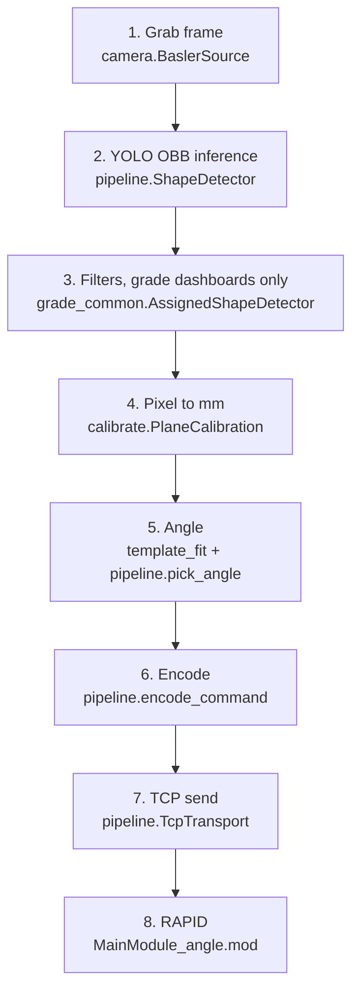

# How the pipeline works (detail)

This page explains each step from camera frame to robot move, with the real numbers from the
code. File names point to where each step lives.

Not every program runs every step:

| Step | `live_pick.py` | `dashboard_web.py` | grade dashboards (`gradeN_web.py`) |
| --- | --- | --- | --- |
| 1. Camera | one frame (or `--image`) | live, 6 fps | live, 6 fps |
| 2. Inference | yes | yes (`--imgsz`) | yes (`--imgsz`, `--conf`) |
| 3. Filters (shape, size, white) | **no** | **no** | yes |
| 4-6. mm, angle, wire format | yes | yes | yes |
| 7. Send | all lines at once (`--send`) | one line per Pick | one line per Pick |



## 1. Camera (`scripts/camera.py`)

- `BaslerSource` opens the **first** Basler camera that pylon finds, converts frames to
  `BGR8packed` and returns NumPy arrays (2448 x 2048 x 3 for the acA2440).
- In the web dashboard (`dashboard_web.WebWorker`) one thread captures and one thread runs
  inference. Capture is limited to **6 fps** (`CAPTURE_FPS`); converting all ~75 fps kept the
  CPU busy and slowed inference to about 2 s.
- The browser gets every second pixel (`PREVIEW_STEP = 2`, 1224 px wide, JPEG quality 70).
- Only one program can open the camera at a time.

## 2. Inference (`scripts/pipeline.py`)

- `ShapeDetector` wraps `ultralytics.YOLO`. Default weights are found in this order:
  `best_ncnn_model/`, `best.onnx`, `best.pt` under `runs/obb/obb_train/weights/`.
- The model's class list must be exactly `("circle", "square", "hexagon", "star", "triangle")`
  (`check_model_names`), otherwise it stops.
- Defaults: `conf = 0.25`, `imgsz = 640` (dashboard `--imgsz`).
- Each result becomes a `Detection`: class id, confidence, centre (px), box angle (deg) and the
  four box corners.
- `print(f"inference: {ms} ms")` after each frame. The grade pages show it and turn red
  above 3000 ms.
- The dashboard runs one inference on a black frame at start-up ("warming up the model"),
  because the first NCNN run takes about 20 s.

## 3. Filters (`grade_levels/grade_common.py`)

Only in the grade-level dashboards (`AssignedShapeDetector`). Each dropped detection is
printed once, with the reason.

| Filter | Rule | Option |
| --- | --- | --- |
| Assigned shapes | keep class ids 0, 2, 4 (circle, hexagon, triangle) | - |
| Confidence | below `--conf` is dropped | `--conf 0.25` |
| Star check | outline area / convex-hull area < **0.80** -> it is a star (stars ~0.6, solid shapes 0.95+) | `--no-shape-check` |
| Square check | outline has **4 corners** and fills >= **0.90** of its tightest box -> it is a square | `--no-shape-check` |
| Size | smaller than **38 mm** across -> a pin (sheet magnet), not a part | `--min-size-mm 0` turns off |
| White | white parts are dropped (instructor's rule) | `--allow-white` |

The size is the longest side of the detection box, in mm (measured with
`data/calibration.json`; without a calibration file there is no size check).

The outline is found by separating the part from the sheet around its box (same method as
`pipeline.refine`), then closing and opening the mask. If no clear outline is found (for
example a white part on the white sheet), the check gives no verdict and the part is kept.

**Colour** (`part_colour`): a patch at the part centre (20 % of the part size) is compared with
a ring of sheet just outside the box.

A pixel counts as "saturated" when its HSV saturation is at least 60 and its value at least 40
(OpenCV scale 0-255).

- At least 60 % saturated pixels -> hue decides: red (hue 0-10 or 170-180), green (35-85),
  blue (100-140). Orange falls in the red band.
- Centre brightness below 0.60 of the sheet -> black.
- At least 0.85 of the sheet and less than 20 % saturated pixels -> white.
- Otherwise the whole-box answer from `pipeline.colour_of` is used.

The plain `dashboard_web.py` (no grade) uses `pipeline.colour_of` (HSV votes over the whole box).

## 4. Pixel to millimetre (`scripts/calibrate.py`)

- `calibrate.py` finds ArUco marker **id 0** from `DICT_5X5_100` (with a second try after a
  contrast boost (CLAHE) for dim frames) and sub-pixel corners. `--live` tries up to 10 camera
  frames and saves the last one as `calib_fail.png` if the marker is never found.
- The four corners are turned so that **+x = image right** and **+y = image up**
  (`upright_turns`), then mapped onto a 100 mm square centred on (0, 0). The result is a
  3 x 3 **homography**, saved in `data/calibration.json` as `matrix`.
- A homography also removes the "trapezoid" from a camera that is not exactly above the sheet.
  The scalar `mm_per_px` is only printed for comparison (`live_pick.py --scalar` uses it).
- `marker_moved()` compares the marker in each new frame with the saved centre. More than
  **15 px** -> `live_pick.py`, `verify_positions.py` and `teach_angle.py` stop. The dashboard
  warns above **6 px**. If the marker is not visible in the frame, the check is skipped.
- The robot work object `wobjS` must use the same frame: origin at the marker centre, same
  x and y directions.

## 5. Angle (`scripts/template_fit.py`, `scripts/pipeline.py`, `scripts/teach_angle.py`)

1. **Raw angle.** For square, hexagon, triangle and star, `template_fit.fit_detection` rasterises
   a millimetre template of the shape (0.25 mm cells; square side 45 mm, triangle side 50 mm,
   hexagon 50 mm across flats, star 34 mm between neighbouring tips) onto the part outline
   (already turned into mm by the homography). It searches the angle in 1 deg steps, then a
   shift of up to +-1 mm in 0.5 mm steps, then the angle again in 0.1 deg steps. The score is
   the overlap (intersection over union). The fit is used when the score is at least 0.85
   (star 0.72) and the part is 0.8 to 1.2 times the template size. Otherwise the outline
   heading or the box edge is used ("fallback"; `live_pick.py --send` and `teach_angle.py`
   refuse fallback parts unless `--allow-fallback`).
   For triangle and star the centre also comes from the fit or the outline (their box centre
   is not the part centre).
2. **Symmetry fold.** `fold_to_symmetry` folds the angle into one period centred on 0:
   hexagon 60 deg (-30..30), triangle 120 deg, square 90 deg, star 72 deg. The circle always
   sends 0.
3. **Angle teach.** `apply_angle_teach()` reads `data/angle_teach.json`. For each taught shape:
   `angle = sign * fold(theta + offset - theta0)`. `sign` is the robot's turn direction compared
   with the camera (-1 in the shipped file).
   - Every taught shape must agree on the sign, or the file is ignored and **sending is refused**.
   - A shape that needs an angle but is not taught -> its picks are refused.

### Angle teach measurement

`MainModule_angle.mod` `TeachShape n` takes the seated part out of its pocket and drops it on
the sheet at `(nTeachX, nTeachY) = (-120, 60)` mm, first with turn 0 and then turned
`nTeachTurn = 20` deg. `teach_angle.py --turn 0` measures `theta0`, `--turn 20` measures
`theta1`. `k` is +1 or -1: the direction the part turned in the camera picture when the robot
turned +20 deg. Checks (a failed check stores nothing):

- the residual (measured turn compared with 20 deg) must be at most 3 deg;
- the test turn plus 3 deg must stay below half the symmetry period (hexagon: below 30 deg),
  or the sign would be unclear;
- the part must be within 15 mm of the drop point;
- `--turn 20` must follow `--turn 0` within 15 minutes;
- live mode takes the circular median of 5 frames (`--frames`); their spread must be at most
  2 deg;
- frames where the template fit was not used are refused unless `--allow-fallback`.

The stored zero is the mean of both drops (`theta0` and `theta1 - k * 20`).

## 6. Wire format (`pipeline.encode_command`)

```
slot;x_mm;y_mm;z_mm;angle_deg\n
```

- One decimal for every number. `encode_command` builds the text; `TcpTransport.send_line`
  adds the newline.
- Slot: circle 1, square 2, hexagon 3, triangle 4, star 5 (`pipeline.SLOT`).
- z = `PICK_Z_MM` = 10.0 mm.
- Example: `3;-85.2;41.7;10.0;-12.5`.
- `decode_command` is the reverse and is used by the tests.

## 7. Transport (`pipeline.TcpTransport`)

- The Pi is the **TCP server**: `open()` binds `host:port`, `accept()` waits up to 30 s for
  one robot connection.
- `--host` must be one of the Pi's own addresses. A wrong address gives a clear message
  (`bind_error_message`).
- The dashboard sends one command per Pick from a background sender thread.

## 8. RAPID (`rapid/MainModule_angle.mod`)

```
main:
  Initialize (vacuum off, lamp off, MoveJ Start)
  pendant: "Waiting for PC (dashboard or live_pick --send)"
  ConnectToPC (retry every 2 s)
  loop:
    line := RobotClientReciveMessage()     (from ServerCommuncatio.sys; also shown on the pendant)
    strip CR / LF at the end
    "quit"                 -> leave the loop
    not 5 numbers          -> "Bad message"
    slot not 1..5          -> refuse
    |x|,|y| > 200 or z not 0..40 -> "Outside the sheet - ignored."
    |angle| > 180          -> refuse
    else:
      lamp on, wait for yellow button press (0 then 1), lamp off
      PickAt x, y, z, angle    (pickBase pose at x, y, z, turned by angle about the cup axis
                                (RelTool Rz), in wobjS: 60 mm above, down, vacuum on, 1 s, up)
      PlaceAt pocket(slot)     (in wobjD: 60 mm above, down, vacuum off, 1 s, up; no extra turn)
      "Done."
  ERROR ERR_SOCK_CLOSED -> reconnect and RETRY
```

`PlaceAt` adds no turn: the pick already turned the cup to line the part up with its pocket.
